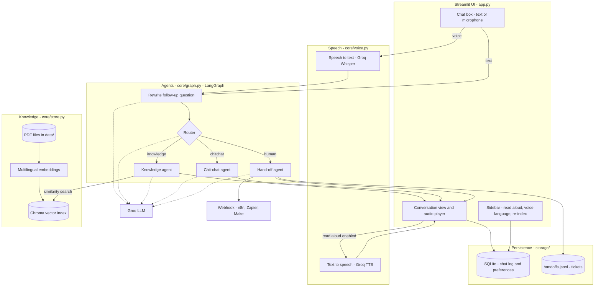
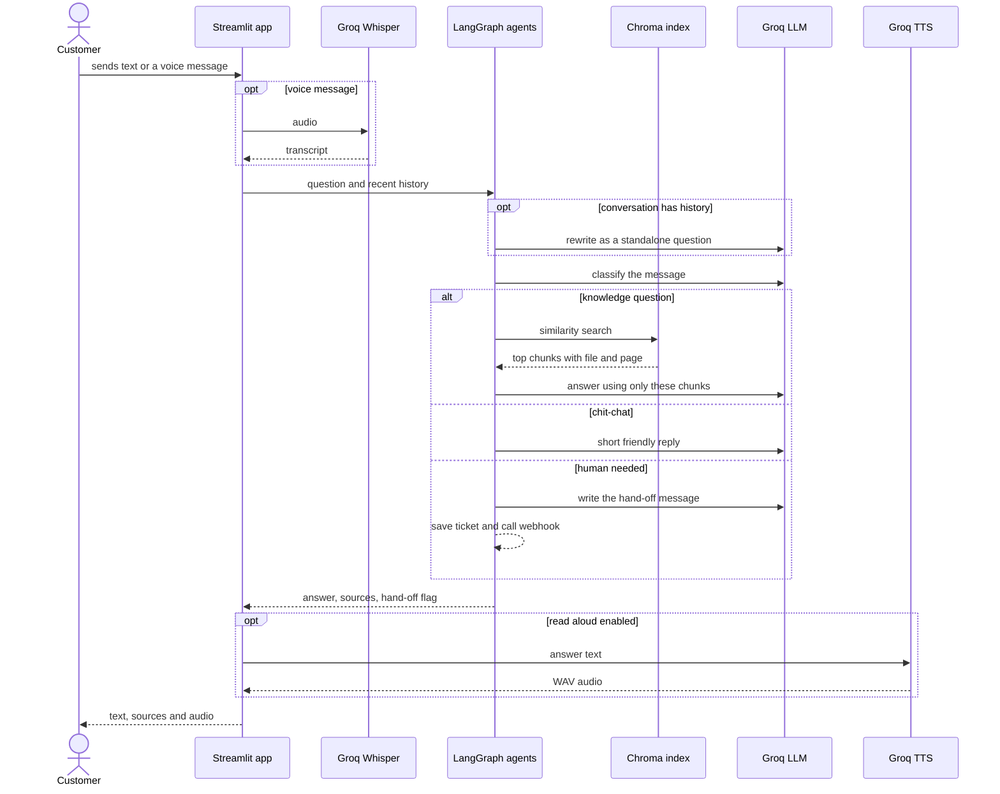
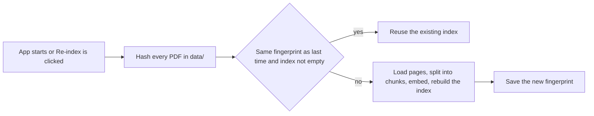

# Support Assistant

A document-grounded customer-support assistant. Customers type or speak a question, and the assistant answers from your own PDF files, cites the file and page it used, remembers the conversation, and escalates to a human when it should.

It supports Arabic and English end to end: a question in one language finds relevant text in the other, and the reply comes back in the customer's language.

## Contents

1. [Features](#features)
2. [Architecture](#architecture)
3. [Components](#components)
4. [Data and storage](#data-and-storage)
5. [Design decisions](#design-decisions)
6. [Getting started](#getting-started)
7. [Configuration](#configuration)
8. [Extending the system](#extending-the-system)
9. [Testing](#testing)
10. [Privacy and limitations](#privacy-and-limitations)
11. [Roadmap](#roadmap)
12. [Troubleshooting](#troubleshooting)

## Features

- **Grounded answers.** Replies are generated only from retrieved PDF passages. Each answer shows its sources. When the documents do not cover a question, the assistant says so and offers a human agent instead of guessing.
- **One chat box, text or voice.** Type and press Enter, or tap the microphone icon inside the box. Voice is transcribed with Groq Whisper. Answers can optionally be read aloud.
- **Multi-agent routing.** Every message is classified and sent to a knowledge agent, a chit-chat agent or a hand-off agent.
- **Conversation memory.** Follow-up questions are rewritten into standalone questions before retrieval. Chats and user preferences are persisted in SQLite.
- **Escalation automation.** Requests for a person, angry customers, legal threats and fraud reports create a ticket and can trigger a webhook (n8n, Zapier, Make).
- **Self-maintaining index.** PDFs are fingerprinted, and the index is rebuilt automatically only when they change.

## Architecture

### System overview



### Request lifecycle



### Index maintenance



## Components

| Module | Responsibility |
| :--- | :--- |
| `app.py` | Streamlit interface. Reads text or audio from one chat box, calls the agent graph, renders answers, sources and audio, and keeps the sidebar settings |
| `core/graph.py` | LangGraph state machine: rewrite, router, knowledge, chit-chat and hand-off nodes |
| `core/store.py` | PDF loading and chunking, Chroma index, change detection, similarity search, source formatting |
| `core/voice.py` | Whisper transcription, text cleaning for speech, sentence chunking, WAV joining, TTS |
| `core/memory.py` | SQLite access for the chat log and preferences |
| `core/handoff.py` | Writes the ticket file and posts to the webhook if configured |
| `config.py` | Paths, model names, retrieval and history settings, environment loading |
| `diagnose.py` | Health check that tests the key, LLM, embeddings, index, agents and speech models |
| `run.bat` | One-click Windows launcher |

### Agents

| Agent | Triggered when | Behavior |
| :--- | :--- | :--- |
| Rewrite | The conversation already has history | Resolves references such as "it" or "that one" into a standalone question |
| Router | Every message | Chooses `knowledge`, `chitchat` or `human`. Ambiguous output defaults to `knowledge` |
| Knowledge | Questions about products, orders, shipping, returns, payments, accounts, warranty | Retrieves the top chunks, answers only from them, returns the sources |
| Chit-chat | Greetings, thanks, goodbyes | Short friendly reply that states no policy facts |
| Hand-off | The customer asks for a person, is angry, threatens legal action or reports fraud | Writes an apology, saves a ticket, posts it to the webhook, flags the response |

## Data and storage

| Data | Location | Notes |
| :--- | :--- | :--- |
| Source documents | `data/*.pdf` | Provided by you |
| Vector index | `storage/chroma/` | Collection `knowledge_base`, rebuilt when the fingerprint changes |
| Index fingerprint | `storage/chroma/manifest.json` | SHA-256 over PDF names and contents |
| Chat log | `storage/memory.db`, table `messages` | `session_id`, `role`, `content`, timestamp |
| Preferences | `storage/memory.db`, table `prefs` | Read-aloud toggle and voice language |
| Tickets | `storage/handoffs.jsonl` | One JSON object per line: `session_id`, `question`, recent `conversation`, `created_at` |

The `storage/` folder is created at runtime and excluded from version control.

## Design decisions

- **Explicit graph instead of one big prompt.** Routing, rewriting and answering are separate nodes with their own prompts. Each can be tested, replaced or extended without touching the others.
- **Grounding over fluency.** The knowledge prompt forbids using anything outside the retrieved context, and an empty retrieval short-circuits to a safe "I could not find that" reply without calling the model.
- **Safe defaults.** If the router returns something unexpected, the message is treated as a knowledge question, which is the most conservative path.
- **Multilingual embeddings.** One embedding space for Arabic and English means customers can ask in either language regardless of the document language.
- **Content-hash indexing.** Using file contents rather than timestamps avoids unnecessary rebuilds and catches real edits.
- **Failures never break the chat.** Webhook errors are logged and ignored, TTS failure falls back to text, and model errors are shown inline with the real message while the traceback goes to the terminal.
- **Short speech requests.** Long answers are split at sentence boundaries, synthesized in short pieces and joined into one WAV.
- **Testable by injection.** The language model and embeddings are passed in, so the whole pipeline runs in tests with fakes and no network.

## Getting started

Use **Python 3.12**. Newer versions can make the heavy dependencies slow or impossible to install.

### Windows, one click

1. Install Python 3.12 (`winget install Python.Python.3.12`).
2. Double-click `run.bat`. It creates the virtual environment, installs the dependencies, opens `.env` for your key, and starts the app.

### Manual

```bash
python --version                      # should print 3.12.x
python -m venv .venv
.venv\Scripts\activate                # macOS/Linux: source .venv/bin/activate
pip install -r requirements.txt
copy .env.example .env                # macOS/Linux: cp .env.example .env
```

Set `GROQ_API_KEY` in `.env` (free key at console.groq.com), then:

```bash
streamlit run app.py
```

The first install is large because of PyTorch, and the first launch downloads the embedding model (roughly half a gigabyte). Both happen once. Run `python diagnose.py` at any point to check every component.

### Using it

1. Type in the box and press Enter, or tap the microphone icon, speak, and send.
2. Turn on **Read answers aloud** in the sidebar to hear replies.
3. Set **Voice language** to Arabic or English if automatic detection gets it wrong.
4. To use your own documents, replace the PDF in `data/` and click **Re-index PDFs**.
5. To test escalation, write "I want to talk to a human agent" and check `storage/handoffs.jsonl`.

## Configuration

| Setting | Where | Default |
| :--- | :--- | :--- |
| `GROQ_API_KEY` | `.env` | required |
| `LLM_MODEL` | `.env` | `llama-3.3-70b-versatile` |
| `STT_MODEL` | `.env` | `whisper-large-v3-turbo` |
| `TTS_MODEL`, `TTS_VOICE` | `.env` | English Orpheus model, voice `autumn` |
| `WEBHOOK_URL` | `.env` | empty, tickets stay in the file |
| `CHUNK_SIZE`, `CHUNK_OVERLAP` | `config.py` | 800 and 120 |
| `TOP_K` | `config.py` | 4 chunks per question |
| `HISTORY_TURNS` | `config.py` | 6 previous exchanges |

For Arabic speech output, set `TTS_MODEL` and `TTS_VOICE` to an Arabic option from the Groq console. Written answers already follow the customer's language.

## Extending the system

To add an agent, for example order tracking:

1. Write a node function in `core/graph.py` that reads the state and returns `answer` and `sources`.
2. Describe the new label in `ROUTER_PROMPT` and handle it in `parse_route`.
3. Register it with `graph.add_node`, add it to the `add_conditional_edges` mapping, and connect it to `END`.

The router, memory, speech layer and UI need no changes. To forward tickets to another system, point `WEBHOOK_URL` at it or extend `core/handoff.py`.

## Testing

```bash
pytest
```

The suite replaces the language model and embeddings with fakes, so it needs no API key or internet. It covers indexing and change detection, search, routing, follow-up rewriting, hand-off tickets, memory, speech helpers, and an end-to-end run of the Streamlit app.

## Privacy and limitations

**Privacy.** Voice recordings are sent to Groq for transcription, and question text plus retrieved passages are sent to Groq for generation. Documents, the index, chat history and tickets stay on the local disk. `.env` holds the API key and must not be committed.

**Limitations.**

- No user authentication. Preferences are shared by everyone using the same instance.
- The UI keeps the visible conversation per browser session. History is logged to SQLite but not reloaded after a page refresh.
- PDF text is extracted with pypdf, so scanned documents without a text layer are not searchable until they are OCR'd.
- Answers are not streamed token by token.
- Webhook delivery has a short timeout and no retry.
- Free Groq tiers have rate limits.

## Roadmap

- Real-time voice conversation with LiveKit on top of the same agent graph.
- Tool agents, such as order lookup against a shop API.
- OCR for scanned PDFs.
- Streaming responses.
- Login, per-user history and an admin view of tickets.
- An evaluation set that scores answer accuracy and refusal behavior.

## Troubleshooting

| Problem | Fix |
| :--- | :--- |
| `requirements.txt` or `app.py` not found | You are not inside the project folder. Run `dir` and look for `app.py` |
| Install is very slow, or pip tries many versions | Check `python --version`. Switch to 3.12 and recreate `.venv` |
| "GROQ_API_KEY is missing" | Create `.env` from `.env.example`, add the key, restart Streamlit |
| An error message appears in the chat | Read the message shown, and see the terminal for the full traceback. Run `python diagnose.py` |
| Microphone icon does nothing | Allow microphone access for the page. The app must run on localhost or https |
| No spoken reply | Turn on Read answers aloud. If the TTS model is unavailable, text answers still work |
| Model not found or decommissioned | Set `LLM_MODEL` in `.env` to a model your Groq key can use |

## License

MIT. See `LICENSE`. Replace `<YOUR NAME>` in the copyright line with your own name.
