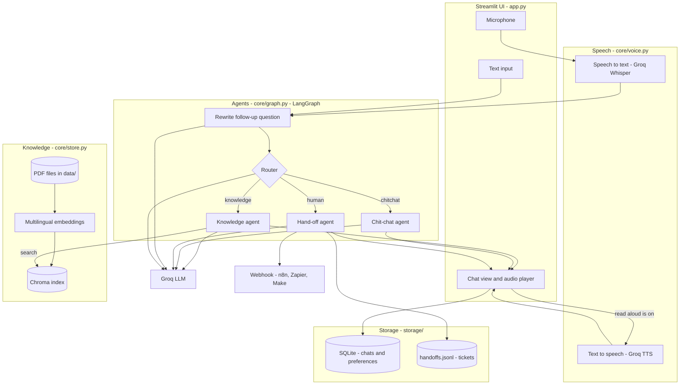
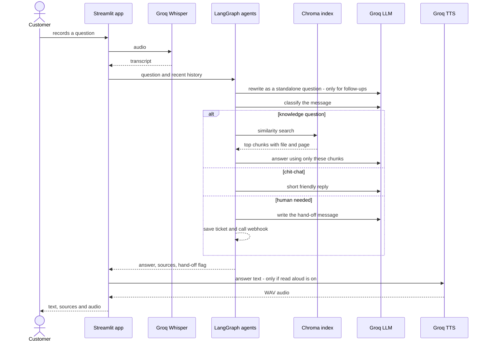
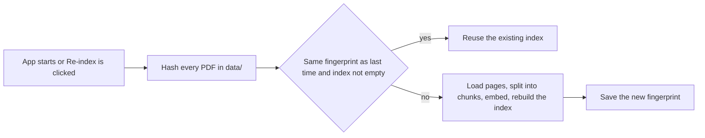

# Support Assistant

A customer-support assistant that answers from your own PDF files. Ask by typing or by recording your voice, and optionally hear the answer read back. It works in Arabic and English, remembers the conversation, and hands the chat to a human when it should.

## Features

- **Grounded answers.** Replies come only from the PDFs in `data/`, with the file name and page shown under each answer. If the documents do not cover the question, the assistant says so instead of guessing.
- **Type or talk.** Chat box for text, microphone button for voice. Voice is transcribed with Groq Whisper, and answers can be read aloud with Groq text-to-speech.
- **Three cooperating agents.** A router sends every message to the knowledge agent, the chit-chat agent or the hand-off agent.
- **Conversation memory.** Follow-ups such as "and how long does that take?" are rewritten into full questions before searching. Chats and preferences are stored in SQLite.
- **Automation.** When a customer asks for a person, is angry, or reports fraud, a ticket is saved and optionally sent to a webhook (n8n, Zapier, Make). PDFs are re-indexed automatically when they change.
- **Arabic and English.** Multilingual embeddings, so an Arabic question finds an English paragraph and the reply comes back in the customer's language.

## Architecture

### System overview



### What happens to one question



### How the PDFs are indexed



### The agents

| Agent | Triggered when | What it does |
| :--- | :--- | :--- |
| Rewrite | The chat already has history | Turns a follow-up into a standalone question so the search finds the right text |
| Router | Every message | Chooses `knowledge`, `chitchat` or `human`. Anything unclear defaults to `knowledge` |
| Knowledge | Questions about products, orders, shipping, returns, payments, warranty | Searches the index (top 4 chunks) and answers only from them, citing file and page |
| Chit-chat | Greetings, thanks, goodbyes | Short friendly reply, no facts about policies |
| Hand-off | The customer asks for a person, is angry, threatens legal action or reports fraud | Apologizes, writes a ticket to `storage/handoffs.jsonl`, and posts it to `WEBHOOK_URL` if set |

### Where data lives

| What | Where |
| :--- | :--- |
| Your documents | `data/*.pdf` |
| Vector index and fingerprint | `storage/chroma/` |
| Chat log and preferences (read aloud, voice language) | `storage/memory.db` |
| Hand-off tickets | `storage/handoffs.jsonl` |

A ticket contains `session_id`, `question`, the last turns of the `conversation`, and `created_at`.

## Project structure

```text
support-voice-rag/
├── app.py              Streamlit interface: chat, microphone, settings
├── config.py           All settings in one place
├── core/
│   ├── graph.py        LangGraph agents: rewrite, router, knowledge, chit-chat, hand-off
│   ├── store.py        PDF loading, chunking, Chroma index, search, change detection
│   ├── voice.py        Speech-to-text and text-to-speech
│   ├── memory.py       SQLite chat log and preferences
│   └── handoff.py      Ticket file and optional webhook
├── data/               Your PDFs
├── storage/            Created at runtime (index, database, tickets)
├── tests/              Offline tests with fake models
├── requirements.txt
└── .env.example
```

## Tech stack

| Part | Choice |
| :--- | :--- |
| UI | Streamlit |
| Agent orchestration | LangGraph on LangChain |
| LLM, speech-to-text, text-to-speech | Groq |
| Embeddings | `paraphrase-multilingual-MiniLM-L12-v2` (sentence-transformers) |
| Vector database | Chroma |
| Memory | SQLite |
| PDF parsing | pypdf |

## Getting started

Use **Python 3.12**. Newer versions can make the heavy dependencies (torch, chromadb) slow or impossible to install.

```bash
python --version                      # should print 3.12.x
python -m venv .venv
.venv\Scripts\activate                # macOS/Linux: source .venv/bin/activate
pip install -r requirements.txt
copy .env.example .env                # macOS/Linux: cp .env.example .env
```

Open `.env`, set `GROQ_API_KEY` (free key from console.groq.com), then start the app:

```bash
streamlit run app.py
```

The first install is large because of PyTorch, and the first launch downloads the embedding model (roughly half a gigabyte). Both happen only once.

## Using it

1. Type in the box, or press the microphone, speak, and stop.
2. Turn on **Read answers aloud** in the sidebar to hear replies.
3. Set **Voice language** to Arabic or English if automatic detection gets it wrong.
4. To use your own documents, replace the PDF in `data/` and click **Re-index PDFs**.
5. To test the hand-off, write "I want to talk to a human agent" and check `storage/handoffs.jsonl`.

## Configuration

| Setting | Where | Default |
| :--- | :--- | :--- |
| `GROQ_API_KEY` | `.env` | required |
| `LLM_MODEL` | `.env` | `llama-3.3-70b-versatile` |
| `TTS_MODEL`, `TTS_VOICE` | `.env` | English Orpheus model, voice `autumn` |
| `WEBHOOK_URL` | `.env` | empty (tickets stay in the file) |
| `CHUNK_SIZE`, `CHUNK_OVERLAP` | `config.py` | 800 and 120 |
| `TOP_K` | `config.py` | 4 chunks per question |
| `HISTORY_TURNS` | `config.py` | 6 previous exchanges |

For Arabic speech output, set `TTS_MODEL` and `TTS_VOICE` to an Arabic option from the Groq console. Written answers are already in the customer's language.

## Extending it

To add an agent, for example order tracking:

1. Write a node function in `core/graph.py` that reads the state and returns `answer` and `sources`.
2. Describe the new label in `ROUTER_PROMPT` and handle it in `parse_route`.
3. Register the node with `graph.add_node`, add it to the `add_conditional_edges` map, and connect it to `END`.

The router, memory, voice and UI need no changes.

## Tests

```bash
pytest
```

The suite uses fake language models and embeddings, so it needs no API key or internet. It covers indexing, search, routing, follow-up rewriting, hand-off tickets, memory, text-to-speech helpers, and an end-to-end run of the Streamlit app.

## Troubleshooting

| Problem | Fix |
| :--- | :--- |
| `requirements.txt` not found | You are not inside the project folder. Run `dir` and look for `app.py` |
| Install is very slow or pip keeps trying many versions | Check `python --version`. Switch to 3.12 and recreate `.venv` |
| "GROQ_API_KEY is missing" | Create `.env` from `.env.example`, add the key, restart Streamlit |
| Microphone button does nothing | Allow microphone access for the page in the browser |
| No spoken reply | Turn on Read answers aloud. If the TTS model is unavailable, text answers still work |

## License

MIT. See `LICENSE` 